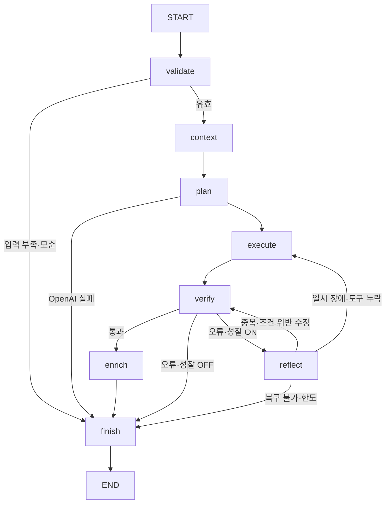

# 설계와 API 계약

## 그래프

`StateGraph`를 compile하고 요청마다 `ainvoke`로 실행합니다. 실시간 모드의 OpenAI 모델은 제한된 도구 이름을 JSON Schema로 선택합니다. 필수 도구 누락·후보 조건 위반·중복은 결정적 검증으로 감지합니다. 성찰 노드는 구조화된 오류에 따라 계획 보완·필터링·재실행 전략을 선택합니다. 이 버전의 성찰은 **규칙 기반 피드백 루프**이며 별도의 LLM 비평 호출은 없습니다. LLM 자유 추론을 실제 데이터 검증으로 대체하지 않습니다.

## 상태 필드

아래 필드는 실행 결과로 저장합니다. `started`만 프로세스 내부 단조 시계이므로 저장하지 않습니다. 새로운 요청에서는 조건·기억만 복원하고 오류·횟수·후보는 초기화합니다.

| 필드 | 의미·자료형 | 초기값 | 읽기 / 갱신 노드 |
| --- | --- | --- | --- |
| run_id | 실행 UUID, str | 새 UUID | API / API |
| thread_id | 대화 UUID, str | 새 UUID 또는 기존 값 | API / API |
| conditions | 정규화 조건, dict | 기억→대화→현재 입력 병합 | 전체 / validate |
| message | 보조 메시지, str | 요청 값, 기본 빈 문자열 | context / API |
| summary | 구조화 요약, dict | 이전 요약 또는 빈 객체 | context·plan / context |
| recent_messages | 최근 메시지, list[str] | 이전 최근 메시지 | context / context |
| include_location | 위치 도구 사용, bool | true | plan·verify·reflect / API |
| reflection | 수정 루프 활성화, bool | true | verify / API |
| status | 실행 상태, str | running | 분기·API / validate·plan·reflect·enrich·finish |
| questions | 추가 질문, list[str] | 빈 목록 | API / validate |
| plan | 선택 도구, list[str] | 빈 목록 | execute·verify·enrich / plan·reflect |
| candidates | 검증 대상·최종 후보, list[dict] | 빈 목록 | verify·enrich / execute·reflect·enrich·finish |
| coverage | 출처·건수·페이지·조회 시각, dict | 빈 객체 | enrich·UI / execute |
| traces | 노드별 짧은 실행 근거, list[dict] | 빈 목록 | API·UI / 각 노드 |
| errors | 오류 코드·메시지·복구 가능 여부, list[dict] | 빈 목록 | verify·reflect·finish / 각 검증·실행 노드 |
| iteration | 수정 횟수, int | 0 | reflect / reflect |
| tool_calls | 검색 페이지·센터 확인·좌표 확인 횟수, int | 0 | execute·enrich / execute·enrich |
| tokens | 성공한 모델 계획 응답의 총 토큰, int | 0 | UI / plan |
| started | 단조 시계, float | monotonic() | finish / API, 영속 저장 제외 |
| elapsed_ms | 그래프 실행 시간, int | 종료 시 계산 | UI / finish |
| retry | 수정 후 이동 경로, str | 미설정 | reflect 조건 엣지 / reflect |
| verified | 후보 검증 통과, bool | false | finish / verify |

`tool_calls`에는 입력 코드 검증용 시도 목록 조회와 OpenAI 호출은 포함하지 않습니다. 토큰은 성공한 계획 응답에서 제공한 값만 집계하며 실패한 모델 요청의 비용은 측정하지 않습니다. `elapsed_ms`는 후속 알림 발송 시간을 제외합니다.

추가 저장 필드: `profile_id`, `created_at`, `mode`. 상태는 `completed`, `partial`, `failed`, `awaiting_input` 중 하나로 종료됩니다. 전체 요청 한도 기본 60초, 성찰 최대 2회, 검색 최대 3페이지, 그래프 재귀 한도 35, 도구 호출 예산 기본 30입니다.

## 기억과 영속성

- 그래프 상태: 현재 실행 범위. 원본 후보는 현재 실행에서만 판단에 사용.
- 단기 기억: 소유자·thread_id 단위의 conditions, summary, recent_messages.
- 장기 기억: 소유자·profile_id 단위로 사용자가 확인한 species·breed·color·features만 저장.
- 우선순위: 현재 요청의 명시 값 > 동일 대화 조건 > 선택적으로 조회한 확인된 기억.
- 기본 프로필은 `default`. 프로필이 다른 상태로 기존 대화에 접근하면 409.
- 요청 후 대화 상태를 저장해 추가 질문 재개와 프로세스 재시작 후 후속 요청을 지원.
- LangGraph 노드 중간 단계의 내구성 체크포인터는 아직 연결하지 않음. 실행 중 강제 종료 시 해당 요청을 재실행해야 함. 노드 단위 재개를 구현했다고 표현하지 않음.

요약은 최근 메시지 6개 또는 3,000자 초과 시 수행합니다. 검색 조건과 미해결 질문은 구조화 필드로 보존하고 과거 대화의 자유 텍스트는 제한합니다. 모델에는 현재 조건·이전 구조화 조건만 전달하며 최대 10개의 bounded 조건 필드로 입력 크기를 제한합니다. 토큰 기반 정밀 예산 대신 문자 수 상한을 사용합니다. 자유 텍스트 요청의 자연어 조건 추출은 미구현이며 UI의 구조화 입력이 기준입니다.

## 저장소

`documents(owner, kind, id, data jsonb, updated_at)`가 데모의 논리 저장소입니다. kind는 identity, thread, memory, saved, run, subscription, notification입니다. 각 API는 owner 조건을 반드시 포함합니다. 단일 테이블은 데모 구현을 단순화하기 위한 선택이며 규모가 커지면 정규화된 테이블·인덱스·보존 기간으로 분리해야 합니다.

서버가 token_urlsafe(32)를 발급하며 원문은 브라우저 localStorage에만, 서버에는 SHA-256 해시만 저장합니다. 로그인·정식 계정 복구 기능은 아닙니다. Supabase Data API는 서버 전용 역할만 허용합니다. rate limit·소유자 동시 실행 잠금은 단일 프로세스 메모리에 있고 다중 인스턴스 분산 제한은 미구현입니다. 토큰·문서의 자동 만료·청소는 후속 범위입니다.

알림 claim은 `(owner, kind, id)` 고유키로 원자적으로 생성합니다. 발송 중 프로세스가 종료되면 pending 상태가 남을 수 있으며 정확히 한 번 전달을 보장하지 않습니다. 운영용 영속 큐·수신 콜백·자동 복구는 후속 범위입니다. 실패·수락 불명 상태를 자동 재발송하지 않아 중복을 줄입니다.

## 도구 계약

| 도구 | 입력 | 출력 |
| --- | --- | --- |
| 시도 조회 | 없음 | 공식 코드·명칭. live: `sido_v2` |
| 공고 검색 | 지역·기간·종류, 페이지 상한 | 정규화 후보·조회 범위. live: `abandonmentPublic_v2` |
| 보호센터 확인 | 공고 원본 후보 | 원 응답의 careNm·careTel·careAddr, 별도 가짜 endpoint 없음 |
| 위치 확인 | 보호센터 주소 | Kakao Local 좌표 또는 주소·실패 이유 |

별도 공고 상세 API를 발명하지 않습니다. 상세 화면은 이번 실행의 원본 정규화 후보를 보여 줍니다. 오래된 저장 검색을 불러오면 조건만 복원하고 외부 데이터는 재조회합니다. 실제 서버의 웹훅 지원은 확인되지 않았으므로 자동 신규 공고 감지를 구현하지 않았습니다.

## API

공통 접두어 `/api/v1`. sessions, health, regions 외에는 `Authorization: Bearer <데모 토큰>` 필요. 요청 모델과 응답은 실행 서버 `/docs`, `/openapi.json`에서 확인합니다.

| 메서드 | 경로 | 동작·주요 입력 |
| --- | --- | --- |
| GET | /health | 실행 모드·저장소·모델·지원 채널 |
| POST | /sessions | 토큰 발급 (201) |
| GET | /regions | 시도 이름·코드 |
| POST | /searches | conditions, reflection, include_location, use_memory, thread_id, profile_id |
| GET | /runs | 소유자의 최근 실행 최대 100개 |
| GET | /runs/{id} | 소유자의 실행 상세 |
| POST | /saved-searches | name, conditions (201) |
| GET | /saved-searches | 소유자의 저장 검색 |
| DELETE | /saved-searches/{id} | 관련 알림 신청도 해제 (204) |
| GET | /memory/{profile_id} | 확인된 특징 |
| PUT | /memory | profile_id, confirmed=true, conditions |
| DELETE | /memory/{profile_id} | 특징 삭제 (204) |
| POST | /subscriptions | saved_search_id, recipient, consent=true, channel=discord (201) |
| GET | /subscriptions | 수신자 ID를 제외한 본인 신청 |
| DELETE | /subscriptions/{id} | 신청 해제 (204) |
| GET | /notifications | 본인 발송 상태·실패 사유 |

저장 검색 수정은 불러온 조건을 편집해 새로 저장한 뒤 기존 검색을 삭제하는 UI 흐름입니다. 별도 PATCH endpoint는 없습니다.

오류: 401 세션 불일치, 404 소유한 자원 없음, 409 프로필 충돌, 422 요청 형식·조건 오류, 429 단일 프로세스 rate limit, 502 도구 오류, 503 설정·저장소 오류. 검색 내부 오류는 200 응답의 `status=failed`와 구조화된 errors로 반환해 실행 이력에 남깁니다.
